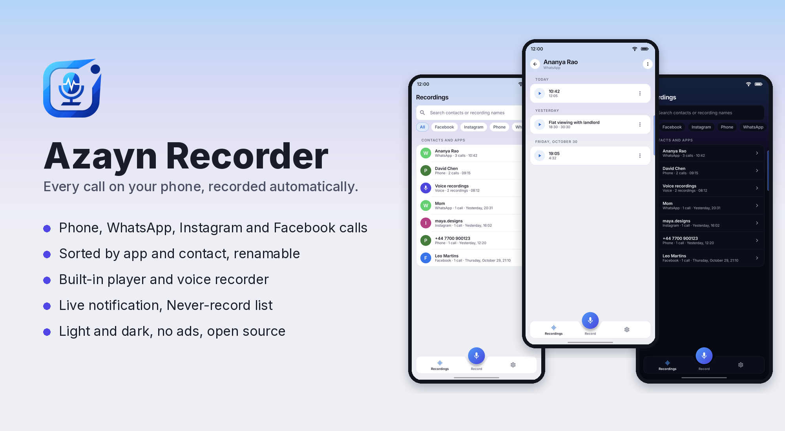
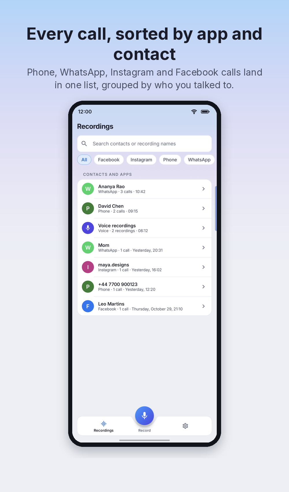
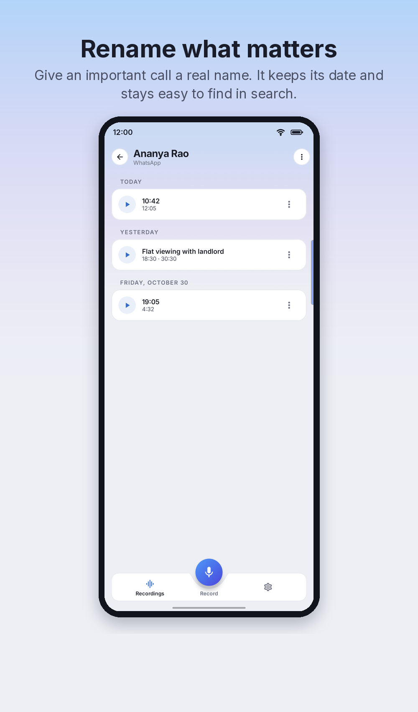
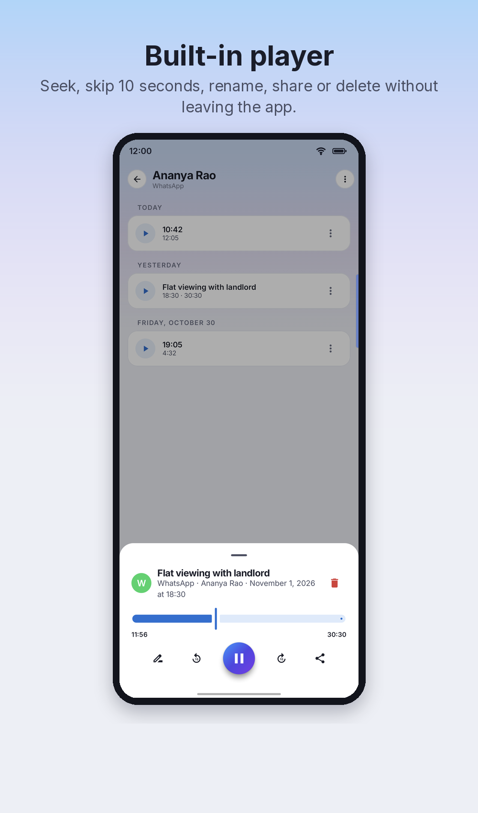
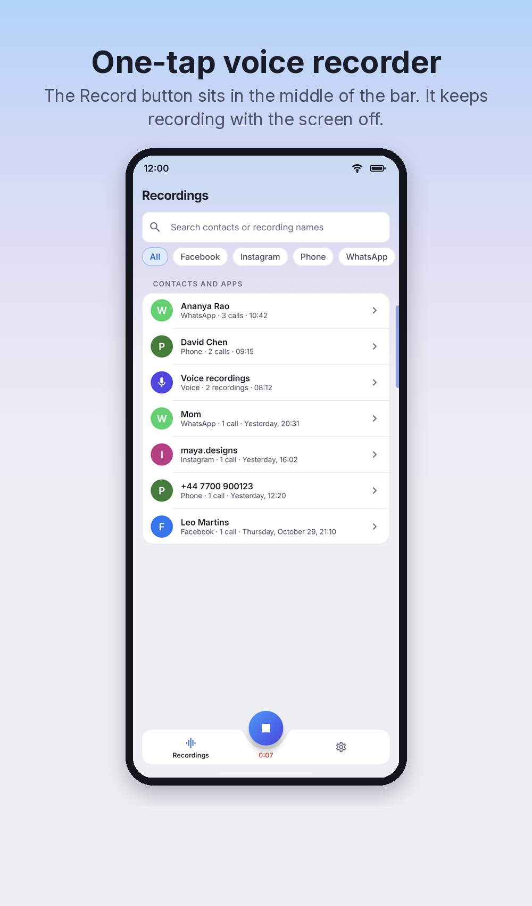
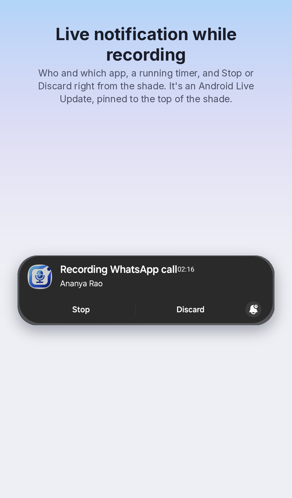
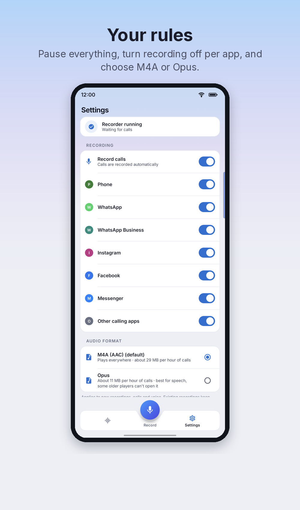
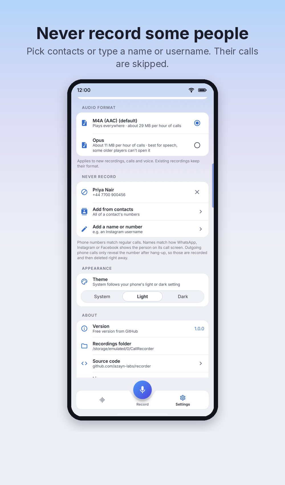
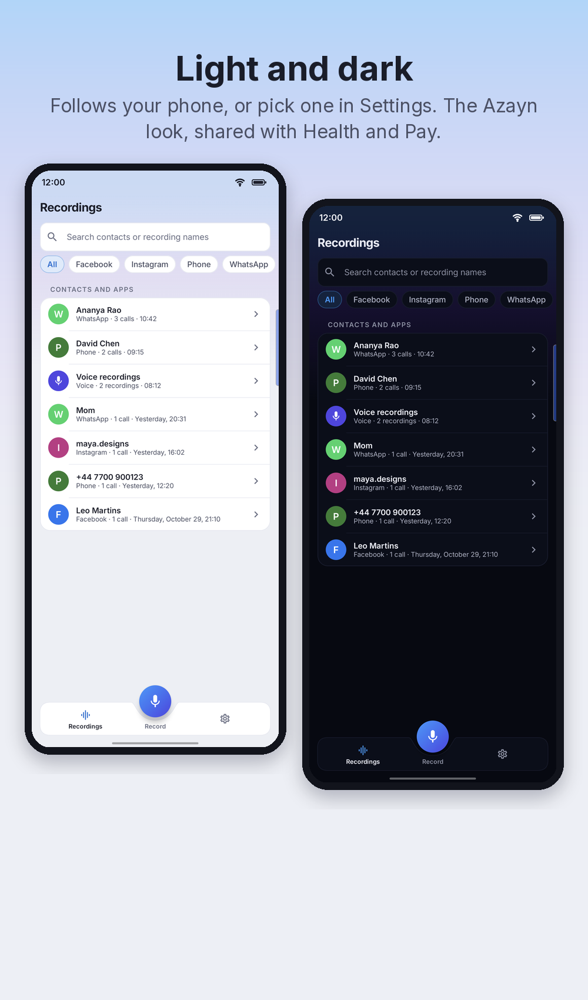

<p align="center"></p>

# Azayn Recorder

Automatic call recorder for a Samsung Galaxy Z Fold 7 (Android 17 / One UI), set up over adb.
It records:

- regular phone calls (SIM / cellular)
- WhatsApp, Instagram and Facebook/Messenger calls (and any other VoIP app)

> **Before you use it:** this is for recording your own calls on your own phone. Recording calls is
> restricted or illegal in many places unless everyone on the call agrees, and you are solely
> responsible for using this software lawfully. Read the
> [legal notice and disclaimer](#legal-notice-and-disclaimer).

## Screenshots

<p align="center">
  
  
  
  
</p>
<p align="center">
  
  
  
  
</p>

<sub>Screenshots use fictional names and numbers. They're rebuilt from on-device captures with
`docs/screenshots/make.py`.</sub>

## Install

1. Turn on **USB debugging** on the phone and connect it to a computer that has `adb`.
2. From the [latest release](https://github.com/azayn-labs/recorder/releases/latest), download
   `AzaynRecorder-vX.Y.Z.apk`, `callrec.dex` and `callrec.sh` into one folder.
3. Run:

   ```bash
   chmod +x callrec.sh
   ./callrec.sh app     # install the app and grant its permissions
   ./callrec.sh start   # start the recorder; it keeps running after you unplug
   ```

Run `./callrec.sh start` again after every phone restart. To build from source instead, see
[Usage](#usage); maintainers publishing a version, see [`docs/RELEASING.md`](docs/RELEASING.md).

## How it works

Normal Android apps can't capture call audio. The `shell` user that adb runs as can,
because it holds `CAPTURE_AUDIO_OUTPUT` and `CAPTURE_VOICE_COMMUNICATION_OUTPUT`.
So the recorder is a small Java daemon (`daemon/src`), compiled to a dex file and started
with `app_process` as the shell user (the same technique scrcpy uses). It detaches from
adb, so it keeps running after you unplug USB, until the phone reboots.

The daemon checks the audio mode every 500 ms:

| Mode | Call type | Captured from |
|---|---|---|
| `MODE_IN_CALL` | cellular | `VOICE_CALL` source (both sides, straight from the modem). Falls back to uplink + downlink, then the mic. |
| `MODE_IN_COMMUNICATION` | VoIP | mic (your voice) + a loopback audio policy on `USAGE_VOICE_COMMUNICATION` (their voice; it still plays on the phone) |

The two sides are mixed to mono and encoded in the format chosen in the app's Settings:

| Format | Calls | Voice recorder | Notes |
|---|---|---|---|
| `.m4a` (AAC), default | 64 kbps, ~29 MB/h | 128 kbps | plays everywhere |
| `.opus` (Ogg Opus) | 24 kbps, ~11 MB/h | 48 kbps | best for speech; some older players can't open it |

The setting applies to new recordings. Existing files keep their format, and the app handles both.

## Files

```
/sdcard/CallRecorder/
  Phone/John Smith/2026-11-02-14-03-11.m4a
  Phone/+44 7700 900123/2026-11-02-16-40-02.m4a    (number not in contacts)
  WhatsApp/Jane Doe/2026-11-02-15-20-45.m4a
  Instagram/john_doe/...
  Facebook/... or Messenger/...
  Recordings/2026-11-02-11-05-16.m4a               (in-app voice recorder)
  Recordings/Flat viewing notes.m4a                (renamed in the app)
```

i.e. `<app>/<contact or number>/YYYY-MM-DD-HH-MM-SS.m4a` (or `.opus`). The contact folder comes from the
call log (phone calls) or the app's ongoing-call notification (VoIP), and is `Unknown` if
neither is available. Recordings under 2 s are dropped.
You can browse them in *My Files › Internal storage › CallRecorder*.

## Companion app (`android/`)

The **Azayn Recorder** app on the phone (package `com.azayn.recorder`; `./callrec.sh app` builds,
installs and grants its permissions):

- **Recordings tab:** one row per app + contact (e.g. "Jane Doe · WhatsApp · 3 calls") plus
  "Voice recordings". Tap a row for that contact's recordings by day. Filter by app, and search
  contacts or recording names. Built-in player (seek, ±10 s), rename, share, delete, and
  "Never record" for a contact. A banner shows when the call recorder is not running or is
  recording right now.
- **Record button:** the round gradient button in the middle of the bottom bar (Health's notched
  bar). It turns into Stop with a running timer while recording. It's a microphone recorder (foreground service, so it keeps going with the
  screen off; stop from the app or the notification). Saves to `Recordings/`, then offers to rename.
- **Live notification:** while a call is being recorded, an ongoing notification shows the
  app, the contact and a running timer, with **Stop** (keep what's recorded so far and skip the
  rest of the call) and **Discard** (delete it). It's an Android Live Update, so it also appears
  as a status-bar chip and in Samsung's Now Bar. The voice recorder shows one too.
- **Look:** the Azayn mobile theme shared with Azayn Health and Pay: Inter, white panels on a
  cool grey ground (navy in dark mode), and the blue-to-violet gradient for primary actions.
  *Settings › Appearance* picks System, Light or Dark.
- **About:** version, source code, license, and *Support Azayn Recorder* (Ko-fi).
- **Rename:** any recording can be renamed. This renames the file itself. The original date
  and time are kept and still shown.
- **Settings tab:** recorder status, a master "Record calls" switch, per-app switches
  (Phone, WhatsApp, Instagram, Facebook, Messenger, other apps), and the **Never record**
  list. Add people from your contacts (all their numbers) or by name/username.

The app and the daemon talk through two files in `/sdcard/CallRecorder`:

- `.config.json`: written by the app, read by the daemon at the start of each call.
- `.status.json`: the daemon's heartbeat, every 2 s.
- `.control`: Stop/Discard from the notification (the daemon reads and deletes it).

The daemon also sends an explicit broadcast to the app's `CallNotifier` receiver when a
recording starts, updates or stops. The receiver requires `android.permission.DUMP`, which
adb shell has and normal apps can't get, so other apps can't fake it.

How the never-record list is enforced:

| Call | Matched by | When |
|---|---|---|
| Incoming phone call | number | before recording starts, so it's never recorded |
| Outgoing phone call | number/name from the call log | after hang-up; the file is deleted right away (Android doesn't expose the dialed number during the call) |
| WhatsApp / Instagram / Facebook | name or username shown in the app's call notification | a few seconds into the call; the partial recording is discarded |

## Usage

```
./callrec.sh start      # build, push, (re)start. Run it again after every phone reboot
./callrec.sh app        # build + install the companion app
./callrec.sh status     # running? + recent log
./callrec.sh log        # follow log (shows each source's peak level during a call)
./callrec.sh selftest   # check which capture sources work on this firmware
./callrec.sh pull [dir] # copy recordings to this PC
./callrec.sh stop
```

Building needs the Android SDK (`$ANDROID_HOME`, platform + build-tools) and a JDK 17+
(Android Studio's bundled one is found automatically).

## Limitations

- **Restart needed after every reboot.** Run `./callrec.sh start` again over USB. Without
  a PC you can use Wireless debugging plus an on-phone adb client (for example Termux's
  `android-tools`) to run the same `app_process` command.
- Any app that switches to communication mode gets recorded (Telegram, Meet, Discord, ...).
  Each one lands in a folder named after its package.

## Support

Azayn Recorder is free and open source. If it's useful to you and you'd like to say thanks, you can
[buy me a coffee on Ko-fi](https://ko-fi.com/azayn). A star on GitHub helps too.

## Legal notice and disclaimer

**Intended use.** Azayn Recorder is designed for individuals to record their own calls on a phone
they own, for personal reference. It is not designed or intended for monitoring other people's
devices, covert surveillance, workplace or employee monitoring, or providing call-recording
services to others. Do not install it on a device you don't own or aren't authorised to configure.
This statement describes the intended purpose and does not change the terms of the Apache
License 2.0.

**Your responsibility for lawful use.** Laws on recording telephone and internet calls differ
between countries, states and regions. Many require the consent of every person on the call, or
that everyone is told the call is being recorded, and some prohibit certain recordings entirely.
Keeping, using or sharing recordings may also be governed by data protection and privacy laws (for
example the GDPR), and by the terms of service of the calling apps involved. You alone are
responsible for finding out which laws apply to you and to the other people on each call, for
obtaining any consent and giving any notice they require, and for how you store, use, disclose and
delete recordings. Do not use this software where doing so would be unlawful.

**No legal advice.** Nothing in this repository, its documentation or the app is legal advice. If
you are unsure whether you may record a call, ask a qualified lawyer in your jurisdiction.

**No warranty.** The software is provided "as is" and "as available", without warranties or
conditions of any kind, express or implied, including fitness for a particular purpose,
non-infringement, accuracy and availability. There is no guarantee that any call will be recorded,
recorded completely, or that recordings will not be lost or corrupted, so do not rely on it where a
missing recording would matter. It depends on developer features of Android (adb) whose behaviour
can change with system or app updates, and you use those features at your own risk.

**Limitation of liability.** To the fullest extent permitted by applicable law, Azayn, its parent
companies, subsidiaries and affiliates, and each of their respective owners, directors, officers,
employees, contributors, licensors and agents (together, the "Azayn Parties") are not liable for
any claim, loss, damage, fine, penalty or expense of any kind, whether direct, indirect,
incidental, special, consequential, exemplary or punitive, and however caused, arising out of or in
connection with the software or its use or misuse. This includes claims of unlawful interception
or recording, invasion of privacy, breach of confidence or data protection law, loss of data or
recordings, and harm to devices. This applies under any theory of liability, whether contract, tort
(including negligence), statute or otherwise, even if an Azayn Party was advised of the possibility
of such loss.

**Indemnity.** To the extent permitted by law, you agree to indemnify and hold harmless the Azayn
Parties against any claim, demand, proceeding, loss or cost (including reasonable legal fees)
brought by a third party or authority that arises from your use of the software, your recordings,
or your breach of any law or of anyone else's rights.

**Trademarks and affiliation.** Samsung, Galaxy, Android, WhatsApp, Instagram, Facebook and
Messenger are trademarks of their respective owners. This project is not affiliated with, endorsed
by or sponsored by any of them; their names are used only to describe compatibility.

**General.** This notice supplements, and does not replace, the disclaimer of warranty and
limitation of liability in sections 7 and 8 of the [Apache License 2.0](LICENSE). If any part of
this notice is held unenforceable, that part is limited to the minimum extent necessary and the
rest remains in effect. Nothing here limits any liability that cannot lawfully be limited or
excluded.

## License

Apache License 2.0, see [`LICENSE`](LICENSE). © 2026 [Azayn](https://azayn.com).

Third-party code and assets are listed in [`NOTICE`](NOTICE): parts of the daemon are adapted from
[scrcpy](https://github.com/Genymobile/scrcpy) (Apache-2.0), and the app bundles the
[Inter](https://github.com/rsms/inter) typeface (SIL Open Font License 1.1).
